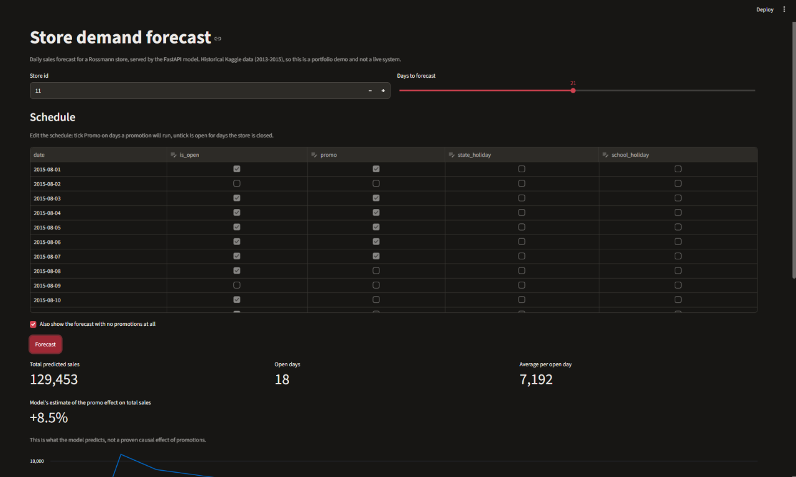
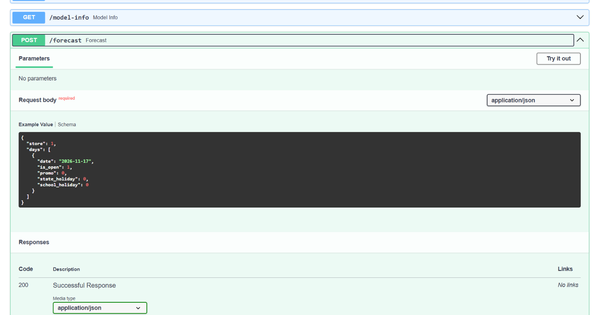
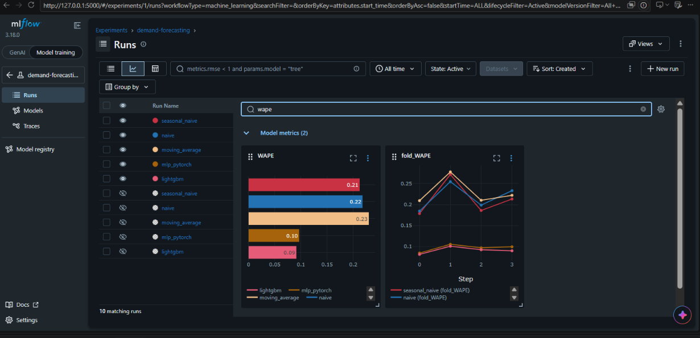
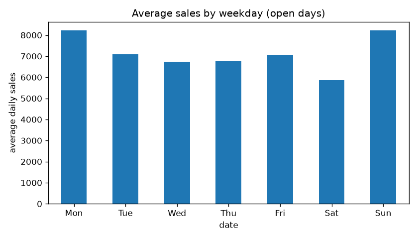
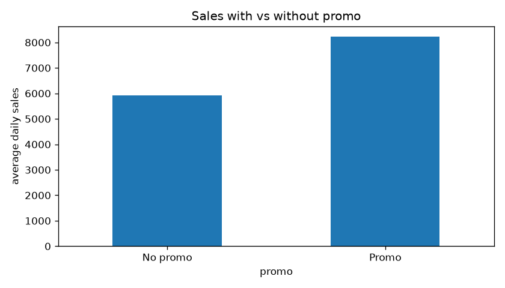
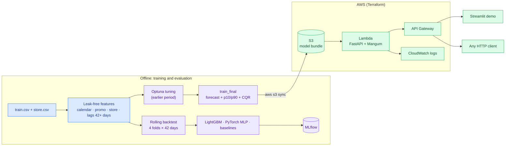

<div align="center">

# 📈 Retail Demand Forecasting

### Leak-free backtest · LightGBM vs PyTorch · calibrated prediction intervals · serverless API on AWS

Forecasts daily sales for **1,115 Rossmann drugstores, up to 42 days ahead**, with an 80% range, and serves them through a **live API on AWS Lambda** and an interactive demo.

🌐 **[Live API](https://hgdnakicif.execute-api.ap-southeast-2.amazonaws.com)** (interactive docs) &nbsp;·&nbsp; 📄 **[Deployment guide](docs/deploy-aws.md)** &nbsp;·&nbsp; 📝 **[Changelog](CHANGELOG.md)**


[](https://github.com/ameerykb/Retail-demand-forecasting/actions/workflows/ci.yml)
[](LICENSE)

**[TL;DR](#-tldr) · [Results](#-results) · [Architecture](#-architecture) · [Features](#-key-features) · [API](#-api) · [Getting started](#-getting-started) · [Deploy](#-deploy-to-aws) · [Testing](#-testing)**

</div>

---

## ⚡ TL;DR

- **Problem:** forecast each store's daily sales 6 weeks ahead from Kaggle's Rossmann data (1M+ rows, 2013 to July 2015).
- **Method:** leak-free features (every sales lag at least 42 days old), a **4-fold rolling backtest**, baselines first, then **LightGBM vs a PyTorch MLP**, tracked in MLflow; Optuna tuning on a period the reported backtest never sees.
- **Result:** LightGBM **WAPE 0.091**, **57% lower error than the best baseline**, and better than the MLP in all four folds.
- **Uncertainty:** every forecast comes with an **80% range** from quantile models, **conformally calibrated** so that about 8 in 10 real values fall inside it.
- **Production:** FastAPI + Pydantic, Docker, **AWS Lambda + API Gateway + S3**, infrastructure in **Terraform**, JSON request logs in CloudWatch.
- **Quality:** 48 tests (including a train/serve consistency test), CI that also runs the Lambda image in AWS's emulator and validates Terraform, pinned dependencies, Dependabot.

| 🏪 Stores | 📅 Horizon | 📉 Error vs best baseline | 🎯 Interval | ✅ Tests |
|:---:|:---:|:---:|:---:|:---:|
| **1,115** | **42 days** | **57% lower** | **80%, calibrated** | **48 passing** |

> **Scope:** the model is trained on historical Kaggle data (2013 to July 2015) and served live on AWS as a demo, so its forecasts cover August–September 2015. Results describe this dataset and this backtest only.

## 🖥️ Demo

An interactive **Streamlit** page: pick a store, edit the schedule (promotion days, closed days, holidays), and see the forecast with its range, optionally next to the same days without promotions. It calls the API; see [hosting it on Streamlit Community Cloud](docs/streamlit-cloud.md).




*The no-promotion line is the model's estimate of the same days without promotions, not a proven causal effect.*

<details>
<summary><strong>📸 The API documentation page</strong></summary>



</details>

## 📊 Results

Backtest: **4 rolling folds**, **42-day forecast window**, scored on days the store was open. **WAPE** (weighted absolute percentage error) is the main metric; lower is better.

| Model | WAPE | MAE |
|---|---:|---:|
| 🥇 **LightGBM** | **0.0912** | **655** |
| 🥈 PyTorch MLP (embeddings) | 0.0966 | 694 |
| Seasonal naive (same weekday last week) | 0.2122 | 1,529 |
| Naive (repeat last value) | 0.2176 | 1,564 |
| Moving average (28 days) | 0.2297 | 1,652 |

- LightGBM reduces WAPE by **57%** compared with the best baseline; the PyTorch model by **54%**.
- LightGBM beat the PyTorch model in **all four folds**, by about 6% on average.

| Fold (cutoff date) | LightGBM | PyTorch MLP | Seasonal naive |
|---|---:|---:|---:|
| 0 (2015-02-14) | 0.0815 | 0.0846 | 0.1785 |
| 1 (2015-03-28) | 0.1008 | 0.1054 | 0.2716 |
| 2 (2015-05-09) | 0.0924 | 0.0970 | 0.1859 |
| 3 (2015-06-20) | 0.0900 | 0.0995 | 0.2131 |



<details>
<summary><strong>📉 MLP training curves</strong></summary>

The MLP uses early stopping on a time-based validation window. In the fold I inspected (fold 2), validation loss stopped improving after about five epochs, so the best checkpoint was restored.


</details>

These figures come from one backtest on this dataset. They are **not** a benchmark against other methods, and they are not comparable to the Kaggle leaderboard.

### Prediction intervals

A single number hides how sure the model is. Each forecast also has an **80% range**:

1. Two extra LightGBM models predict the 10th and 90th percentiles (quantile loss) instead of the mean.
2. Quantile models are usually too narrow, so the range is **calibrated with conformalized quantile regression (CQR)**: on the most recent 42 days before the cutoff, measure how far real values fall outside the range (in log space, so the correction is a percentage that fits small and large stores) and widen by the 80th percentile of those misses.
3. `scripts/evaluate_intervals.py` checks the coverage in the same rolling backtest, before and after calibration (target 0.80). On synthetic data calibration moved coverage from 0.62 to 0.79.

### Tuning and explainability

- **Tuning:** `scripts/tune_lgbm.py` runs an Optuna search with its own rolling backtest on the data **before** the reported test period, so the reported WAPE stays an honest out-of-sample score. The best parameters are saved to `configs/lgbm_best_params.json` and used by every script.
- **Explainability:** `scripts/explain.py` computes exact TreeSHAP values with LightGBM (`pred_contrib=True`) on days the model has not seen and charts the average impact of each feature.

## 🔍 What the data shows

All numbers come from `train.csv` and `store.csv`. Averages are per open store-day.

| | Finding |
|:---:|:---|
| 📅 | **Weekday:** Monday is the busiest day (about 8,200) and Saturday the quietest (about 5,900). Sunday's average looks equally high, but only 33 of the 1,115 stores ever open on a Sunday, so it is not representative. |
| 🎄 | **Month:** sales are highest in December, a jump consistent with Christmas shopping, and lowest in September. The data runs from January 2013 to July 2015, so August to December are averaged over two years and the other months over three. |
| 🏷️ | **Promotions:** days with a promotion average about 8,200 against about 5,900 without, roughly 39% higher. This is a raw comparison, not a causal estimate, because promotions are not assigned at random. |
| 🏬 | **Store type:** type b averages about 10,200 (about 10,000 excluding Sundays) against about 6,800 to 6,900 for types a, c and d, but there are only 17 type b stores. All of them open on some Sundays, and they make up about half of the 33 Sunday-open stores. |
| 🕳️ | **Missing data:** about 180 stores (16%) have no records from July to December 2014 and reappear in January 2015; the dataset does not explain the gap. The dip in total sales over those months is consistent with the missing stores, not necessarily with weaker demand. |

<details>
<summary><strong>📈 Explore the EDA charts</strong></summary>

### Sales by weekday


### Sales by month


### Sales with and without a promotion


### Sales by store type
In this chart, the codes 0 to 3 stand for store types a to d.


### Total daily sales over time


</details>

## 🧭 Architecture



## 🚀 Key features

- **Leak-free features:** the model forecasts 42 days ahead, so every sales-based feature (`lag_42`, `lag_49`, `lag_56`, a 28-day rolling mean and standard deviation) is shifted by at least 42 days. Calendar, promo, holiday, open/closed schedule and store attributes are known in advance and used as they are.
- **Rolling backtest:** no random split. Each model trains on everything before a cutoff, forecasts the next 42 days and is scored on open days. Every model gets the same four folds.
- **Baselines first:** naive, seasonal naive and moving average set the score any model must beat.
- **Two models:** LightGBM on log(1 + sales), and a PyTorch MLP with learned embeddings, a hand-written training loop, seeded shuffling, AdamW and early stopping.
- **Calibrated uncertainty:** quantile models plus conformal calibration; the coverage is measured, not assumed.
- **Honest tuning:** Optuna searches on a period the reported backtest never sees.
- **Experiment tracking:** parameters, per-fold metrics and loss curves in MLflow.
- **Validated API:** Pydantic schemas reject bad input; unknown stores return 404; out-of-range or duplicate dates, bad flags and empty lists return 422.
- **Train/serve consistency test:** the API must return the same numbers as the offline pipeline.
- **Serverless deployment:** Lambda container image behind API Gateway, model in versioned S3 (roll back a bad model), throttling, budget alerts, JSON request logs, all in Terraform.
- **Reproducible:** pinned dependencies, one config file (`src/config.py`), Dependabot updates, pre-commit hooks.

## 🧰 Technology stack

| Layer | Technologies |
|---|---|
| Data & features | pandas, NumPy |
| Models | LightGBM (incl. quantile regression), PyTorch |
| Tuning & tracking | Optuna, MLflow |
| Explainability | TreeSHAP (LightGBM `pred_contrib`), Matplotlib |
| API | FastAPI, Pydantic, Uvicorn, Mangum |
| Demo | Streamlit, Altair |
| Cloud | AWS Lambda (container image), API Gateway HTTP API, S3, ECR, CloudWatch, IAM, AWS Budgets |
| Infrastructure & CI | Terraform, Docker, GitHub Actions, Dependabot |
| Quality | pytest, Ruff, pre-commit |

## 🔌 API

Live: **[https://hgdnakicif.execute-api.ap-southeast-2.amazonaws.com](https://hgdnakicif.execute-api.ap-southeast-2.amazonaws.com)** (opens the interactive docs). The first request after a quiet period takes about 10–20 seconds while Lambda starts; after that responses are fast.

The API takes a store and a **schedule** for the coming days, builds the same features as in training, and returns the predicted sales per day with an 80% range. Dates must fall within 42 days after the last history date; `GET /model-info` reports the window.

| Endpoint | Purpose |
|---|---|
| `GET /health` | 200 if the model is loaded, 503 if not |
| `GET /model-info` | version, valid date window, store ids, interval, features, backtest score |
| `POST /forecast` | forecast for a store, with the schedule you supply |
| `GET /forecast/{store}/default` | quick demo: open Monday to Saturday, closed Sunday, **no promotions** |

Example request to `POST /forecast` (unspecified fields default to open, no promotion, no holiday):

```json
{
  "store": 1,
  "days": [
    {"date": "2015-08-03", "promo": 0},
    {"date": "2015-08-04", "promo": 1}
  ]
}
```

Each day in the response looks like `{"date": "2015-08-04", "predicted_sales": 5213.4, "lower": 4410.2, "upper": 6102.9}`.

## 🗂️ Project structure

```text
Retail-demand-forecasting/
├── app/                        # Streamlit demo (+ its own small requirements.txt)
├── src/
│   ├── config.py               # horizon, folds, quantiles, paths
│   ├── api/                    # FastAPI app, schemas, service, model bundle, S3 loader, Lambda handler
│   ├── data/                   # Rossmann loading and synthetic data
│   ├── features/build.py       # leak-free feature engineering
│   ├── models/                 # baselines, LightGBM, PyTorch MLP, calibrated intervals
│   ├── training/backtest.py    # rolling backtests (models, baselines, intervals)
│   ├── demo/                   # helpers for the demo
│   └── tracking.py             # MLflow logging
├── scripts/                    # run with: python -m scripts.<name>
│   ├── eda.py                  # EDA charts
│   ├── baselines.py            # baselines only
│   ├── backtest_gbm.py         # LightGBM vs baselines + feature importance
│   ├── compare_models.py       # PyTorch MLP vs LightGBM vs baselines, logged to MLflow
│   ├── tune_lgbm.py            # Optuna tuning
│   ├── evaluate_intervals.py   # interval coverage in the backtest
│   ├── explain.py              # SHAP chart
│   └── train_final.py          # model bundle used by the API
├── tests/                      # pytest suite
├── infra/terraform/            # AWS infrastructure as code
├── docs/                       # deployment and hosting guides
├── Dockerfile                  # API container for Docker Compose / any host
├── Dockerfile.lambda           # API container for AWS Lambda
└── .github/                    # CI, deploy workflow, Dependabot
```

## ⚡ Getting started

**Requirements:** Python 3.12 (3.11+ works). Docker is optional.

**Data:** the Kaggle data is **not** included. Download `train.csv` and `store.csv` from [Rossmann Store Sales](https://www.kaggle.com/c/rossmann-store-sales) (subject to its rules) into `data/`. Without them, every script falls back to **synthetic data** so the pipeline still runs; never quote results from synthetic data.

```bash
git clone https://github.com/ameerykb/Retail-demand-forecasting.git
cd Retail-demand-forecasting
python -m venv .venv
source .venv/bin/activate            # Windows: .venv\Scripts\Activate.ps1
pip install -r requirements.txt
```

**Experiments** (all scripts run from the project root):

```bash
python -m scripts.eda                 # charts in reports/figures/
python -m scripts.baselines           # scores to beat
python -m scripts.tune_lgbm --trials 25 --stores 300   # optional: Optuna tuning
python -m scripts.backtest_gbm        # LightGBM vs baselines
python -m scripts.compare_models      # + PyTorch MLP, logged to MLflow
python -m scripts.evaluate_intervals  # 80% interval coverage
python -m scripts.explain             # SHAP chart
mlflow ui --backend-store-uri sqlite:///mlflow.db       # http://127.0.0.1:5000
```

**Serve locally** (two terminals):

```bash
python -m scripts.train_final --backtest-wape 0.0912
uvicorn src.api.main:app --port 8010                    # http://127.0.0.1:8010/docs
```

```bash
API_URL=http://127.0.0.1:8010 streamlit run app/streamlit_app.py   # PowerShell: $env:API_URL="http://127.0.0.1:8010"
```

Or with Docker: `python -m scripts.train_final` then `docker compose up --build`.

## 🌐 Deploy to AWS

The API runs on **AWS Lambda** (container image) behind **API Gateway**, with the model in **S3**, all defined in **Terraform**. Idle cost is close to zero. Step-by-step guide, including the AWS Free plan's limits and how to update code or the model: **[docs/deploy-aws.md](docs/deploy-aws.md)**.

## 🧪 Testing

```bash
python -m pytest
```

48 tests cover metrics and baselines, the no-future-data checks for the backtest and the lag features, LightGBM, quantile models and conformal calibration, the PyTorch model, MLflow logging, the tuning and explainability helpers, the API (including the train/serve consistency check, intervals and request logs), loading the model from S3 and the Lambda handler (with a fake S3 client), and the demo helpers.

CI (`.github/workflows/ci.yml`) runs on every push: lint, tests, the training scripts on synthetic data, a Docker smoke test, the Lambda image through AWS's Runtime Interface Emulator, and `terraform fmt` / `validate`. Run the same lint checks before each commit with `pre-commit install`.

## 🔐 Limitations & responsible use

- **Historical, single-company data** (2013 to 2015), so results say little about other retailers or today's patterns.
- **The schedule is assumed to be known in advance:** promotions, holidays and open/closed days. That holds for this dataset, but in practice promotion plans can change.
- **The quick `/forecast/{store}/default` endpoint assumes no promotions,** so it forecasts lower than a typical month. Use `POST /forecast` with a real schedule.
- **Missing stores:** about 180 stores have no records from July to December 2014. Some lag features for those stores reach back into that gap in the earliest backtest window and are treated as missing values.
- **Scoring is not comparable to the Kaggle leaderboard,** which used a different metric (RMSPE) and a different test split.
- **The interval is calibrated on one recent window;** coverage can drift if demand patterns change. It is a range for one day at a time, not for totals over several days.
- **The MLP trains on slightly less recent data than LightGBM,** because it holds out the last 42 days before each cutoff for early stopping.
- **Not built yet:** drift monitoring and automated retraining.
- **Data and licence:** the dataset is not redistributed here. Follow the Kaggle competition rules when using it. Code is under the [MIT License](LICENSE).

## 👤 Author

**Ameer Yakoob M T**
B.E. Artificial Intelligence & Data Science · Python · Machine Learning · Generative AI

[](https://github.com/ameerykb)
[](https://www.linkedin.com/in/ameer-yakoob-m-t-1b2194287/)
[](https://ameeryakoob.netlify.app/)

---

<div align="center"><sub>Built as a machine learning engineering portfolio project · MIT License</sub></div>
