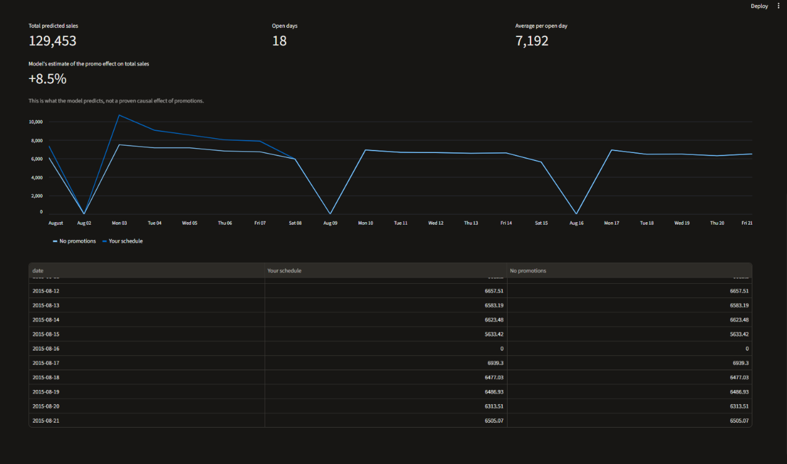
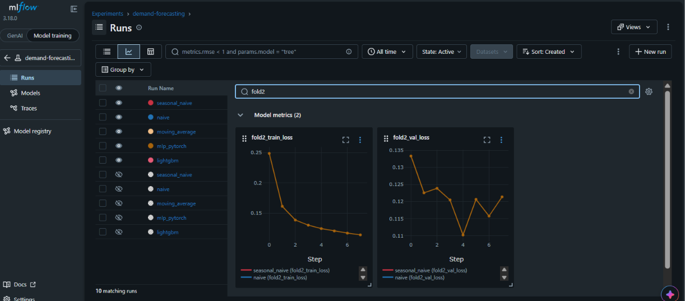
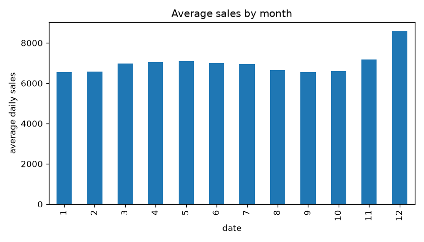
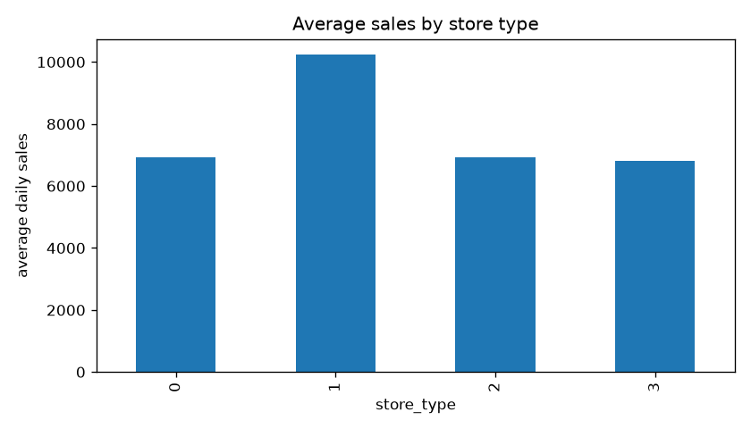
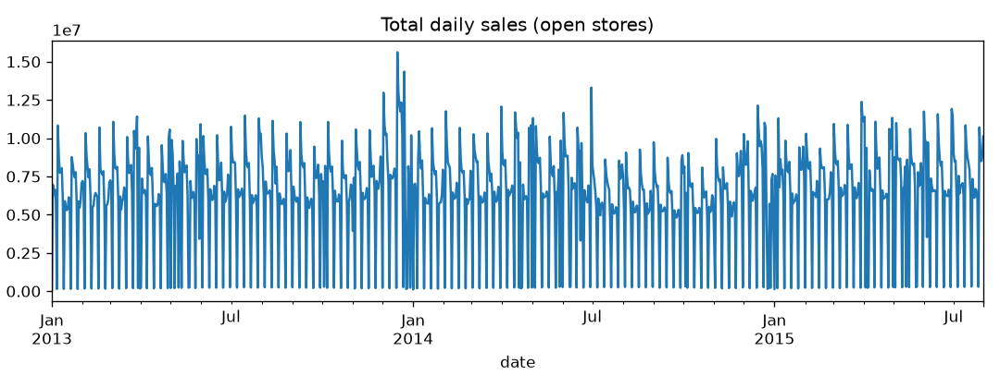
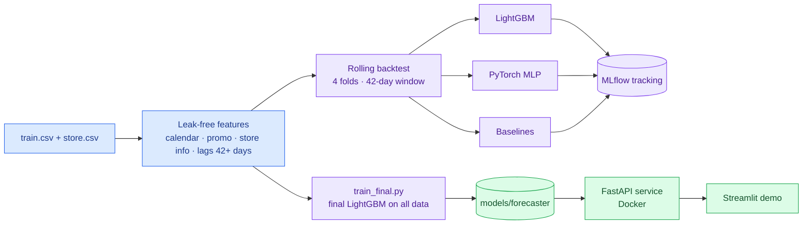
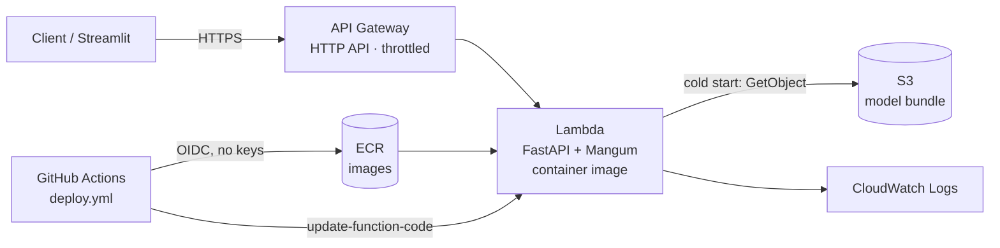

<div align="center">

# 📈 Retail Demand Forecasting

### Leak-free features · Rolling backtest · LightGBM vs PyTorch · FastAPI + Docker

A **sales forecasting system** that predicts daily sales for **1,115 Rossmann drugstores, up to 42 days ahead**, and serves the forecasts through an API and an interactive demo.

**Case study:** Kaggle's *Rossmann Store Sales* data (January 2013 to July 2015).


[](https://github.com/ameerykb/Retail-demand-forecasting/actions/workflows/ci.yml)

**[Results](#-results) · [Data insights](#-what-the-data-shows) · [Architecture](#-system-architecture) · [Features](#-key-features) · [Tech Stack](#-technology-stack) · [Getting Started](#-getting-started) · [Deploy to AWS](#-deploy-to-aws) · [Testing](#-testing)**

</div>

---

## ✨ Project at a glance

| 📊 Forecasting | 🧠 Models & tracking | 🚀 Serving & quality |
|:---|:---|:---|
| Leak-free lag features, rolling-origin backtest, WAPE scored on open days | LightGBM, a PyTorch MLP with embeddings, MLflow experiment tracking | FastAPI with Pydantic validation, Docker, Streamlit demo, Pytest and CI |

| 🏪 Stores | 📅 Forecast window | 📉 Error vs best baseline | ✅ Tests |
|:---:|:---:|:---:|:---:|
| **1,115** | **42 days** | **57% lower** | **34 passing** |

> **Project scope:** this is a portfolio project built on historical data from 2013 to 2015, not a live forecasting system. Results describe this dataset and this backtest only.

## 🖥️ Demo preview

An interactive **Streamlit** page where you pick a store, edit the schedule (promotion days, closed days, holidays), and see the forecast. It calls the FastAPI service.




*The comparison line shows the model's estimate of the same days with no promotions. It is a model prediction, not a proven causal effect.*

<details>
<summary><strong>📸 See the API documentation page</strong></summary>


</details>

## 📊 Results

Backtest: **4 rolling folds**, **42-day forecast window**, scored on days the store was open. **WAPE** (weighted absolute percentage error) is the main metric; lower is better.

| Model | WAPE | MAE |
|---|---:|---:|
| 🥇 **LightGBM** | **0.0912** | **655** |
| 🥈 PyTorch MLP (embeddings) | 0.0966 | 694 |
| Seasonal naive (same weekday last week) | 0.2122 | 1,529 |
| Naive (repeat last value) | 0.2176 | 1,564 |
| Moving average (28 days) | 0.2297 | 1,652 |

- LightGBM reduces WAPE by **57%** compared with the best baseline; the PyTorch model by **54%**.
- LightGBM beat the PyTorch model in **all four folds**, by about 6% on average.

| Fold (cutoff date) | LightGBM | PyTorch MLP | Seasonal naive |
|---|---:|---:|---:|
| 0 (2015-02-14) | 0.0815 | 0.0846 | 0.1785 |
| 1 (2015-03-28) | 0.1008 | 0.1054 | 0.2716 |
| 2 (2015-05-09) | 0.0924 | 0.0970 | 0.1859 |
| 3 (2015-06-20) | 0.0900 | 0.0995 | 0.2131 |


<details>
<summary><strong>📉 MLP training curves</strong></summary>

The MLP uses early stopping on a time-based validation window. In the fold I inspected (fold 2), validation loss stopped improving after about five epochs, so the best checkpoint was restored.



</details>

These figures come from one backtest on this dataset. They are **not** a benchmark against other methods, and they are not comparable to the Kaggle leaderboard.

## 🔍 What the data shows

All numbers come from `train.csv` and `store.csv`. Averages are per open store-day.

| | Finding |
|:---:|:---|
| 📅 | **Weekday:** Monday is the busiest day (about 8,200) and Saturday the quietest (about 5,900). Sunday's average looks equally high, but only 33 of the 1,115 stores ever open on a Sunday, so it is not representative. |
| 🎄 | **Month:** sales are highest in December, a jump consistent with Christmas shopping, and lowest in September. The data runs from January 2013 to July 2015, so August to December are averaged over two years and the other months over three. |
| 🏷️ | **Promotions:** days with a promotion average about 8,200 against about 5,900 without, roughly 39% higher. This is a raw comparison, not a causal estimate, because promotions are not assigned at random. |
| 🏬 | **Store type:** type b averages about 10,200 (about 10,000 excluding Sundays) against about 6,800 to 6,900 for types a, c and d, but there are only 17 type b stores. All of them open on some Sundays, and they make up about half of the 33 Sunday-open stores. |
| 🕳️ | **Missing data:** about 180 stores (16%) have no records from July to December 2014 and reappear in January 2015; the dataset does not explain the gap. The dip in total sales over those months is consistent with the missing stores, not necessarily with weaker demand. |

<details>
<summary><strong>📈 Explore the EDA charts</strong></summary>

### Sales by weekday


### Sales by month


### Sales with and without a promotion


### Sales by store type
In this chart, the codes 0 to 3 stand for store types a to d.



### Total daily sales over time


</details>

## 🧭 System architecture



## 🚀 Key features

- **Leak-free features:** the model forecasts 42 days ahead, so every sales-based feature (`lag_42`, `lag_49`, `lag_56`, a 28-day rolling mean and standard deviation) is shifted by at least 42 days. Calendar, promo, holiday, open/closed schedule and store attributes are known in advance and used as they are.
- **Rolling backtest:** no random split. Each model trains on everything before a cutoff, forecasts the next 42 days, and is scored on open days. Every model gets the same four folds.
- **Baselines first:** naive, seasonal naive and moving average set the score any model must beat.
- **Two models:** LightGBM trained on log(1 + sales), and a PyTorch MLP with learned embeddings, a hand-written training loop, seeded shuffling, AdamW and early stopping.
- **Experiment tracking:** parameters, per-fold metrics and loss curves are logged to MLflow.
- **Validated API:** Pydantic schemas reject bad input; unknown stores return 404, and out-of-range or duplicate dates, bad flags and empty lists return 422.
- **Train/serve consistency test:** a test checks that the API returns the same numbers as the offline pipeline, so training and serving cannot drift apart.
- **Docker:** the image contains only the code; the trained model is mounted at run time.
- **Interactive demo:** a Streamlit page for editing a schedule and comparing it with a no-promotion scenario.

## 🧰 Technology stack

| Layer | Technologies |
|---|---|
| Data & features | pandas, NumPy |
| Models | LightGBM, PyTorch |
| Experiment tracking | MLflow |
| API | Python, FastAPI, Pydantic, Uvicorn |
| Demo | Streamlit |
| Packaging | Docker, Docker Compose |
| Cloud | AWS Lambda (container image), API Gateway HTTP API, S3, ECR, CloudWatch, IAM, AWS Budgets, Mangum |
| Infrastructure as code / CD | Terraform, GitHub Actions with OIDC (no stored AWS keys) |
| Quality | pytest, Ruff, GitHub Actions |
| Charts | Matplotlib |

## 🔌 API

The API takes a store and a **schedule** for the coming days, builds the same features as in training, and returns the predicted sales per day. Dates must fall within 42 days after the last date in the stored history; `GET /model-info` reports the valid window.

| Endpoint | Purpose |
|---|---|
| `GET /health` | 200 if the model is loaded, 503 if not |
| `GET /model-info` | model version, valid date window, features, backtest score |
| `POST /forecast` | forecast for a store, with the schedule you supply |
| `GET /forecast/{store}/default` | quick demo: open Monday to Saturday, closed Sunday, **no promotions** |

Example request to `POST /forecast`:

```json
{
  "store": 1,
  "days": [
    {"date": "2015-08-03", "promo": 0},
    {"date": "2015-08-04", "promo": 1}
  ]
}
```

A day you leave unspecified defaults to open, no promotion, no holiday.

## 🗂️ Project structure

```text
Retail-demand-forecasting/
├── app/streamlit_app.py        # Streamlit demo
├── src/
│   ├── api/                    # FastAPI app, schemas, forecasting service, model bundle
│   ├── data/                   # loading and synthetic data
│   ├── features/build.py       # leak-free feature engineering
│   ├── models/                 # baselines, LightGBM, PyTorch MLP
│   ├── training/               # backtests
│   ├── demo/                   # helpers for the demo
│   └── tracking.py             # MLflow logging
├── tests/                      # Pytest suite
├── run_baselines.py            # baselines only
├── run_gbm.py                  # LightGBM vs baselines
├── run_nn.py                   # PyTorch MLP vs LightGBM vs baselines
├── run_eda.py                  # EDA charts
├── train_final.py              # train the model used by the API
├── Dockerfile                  # container for Docker Compose / any host
├── Dockerfile.lambda           # container for AWS Lambda
├── docker-compose.yml
├── infra/terraform/            # AWS infrastructure as code
└── .github/workflows/          # ci.yml (tests, images, terraform), deploy.yml (AWS)
```

## ⚡ Getting started

**Requirements:** Python 3.10 or newer. Docker is optional.

**Data:** the Kaggle data is **not** included in this repository. Download `train.csv` and `store.csv` from the [Rossmann Store Sales](https://www.kaggle.com/c/rossmann-store-sales) competition (subject to its rules) and put them in a `data/` folder.

**Setup:**

```powershell
git clone https://github.com/ameerykb/Retail-demand-forecasting.git
cd Retail-demand-forecasting
python -m venv .venv
.\.venv\Scripts\Activate.ps1      # Mac/Linux: source .venv/bin/activate
pip install -r requirements.txt
```

**Run the experiments:**

```powershell
python run_baselines.py     # baselines only
python run_gbm.py           # LightGBM vs baselines
python run_nn.py            # PyTorch MLP vs LightGBM vs baselines, logged to MLflow
mlflow ui --backend-store-uri sqlite:///mlflow.db     # open http://127.0.0.1:5000
```

**Train the final model, then start the API and the demo** (two terminals):

```powershell
python train_final.py --backtest-wape 0.0912
uvicorn src.api.main:app --port 8010          # API docs at http://127.0.0.1:8010/docs
```

```powershell
streamlit run app/streamlit_app.py            # demo; needs the API running
```

**With Docker** instead of uvicorn:

```powershell
python train_final.py
docker compose up --build                     # API at http://127.0.0.1:8010/docs
```

Without the Kaggle files, the scripts fall back to **synthetic data** so the pipeline still runs. Never quote results from synthetic data.

### Typical workflow

**Download data → Run baselines → Compare models in a rolling backtest → Track in MLflow → Train the final model → Serve with FastAPI → Explore in the Streamlit demo**

## 🌐 Deploy to AWS

The API runs **serverless on AWS**: the same FastAPI app, wrapped with Mangum, runs as a Lambda container image behind an API Gateway HTTP API. The image holds only code; the trained model is kept in a private S3 bucket and downloaded once per Lambda container at cold start. All of it is defined in Terraform and fits within the AWS Free Tier credits.



**What Terraform creates** (`infra/terraform/`): a private, encrypted S3 bucket for the model; an ECR repository that keeps the last 3 images; the Lambda function with a least-privilege role (it can only read the model files); the HTTP API with throttling; 7-day log retention; a monthly AWS Budget with email alerts; and, optionally, an IAM role that only this repository's `main` branch can assume from GitHub Actions.

**Cost safety:** pick the **Free plan** when you create the AWS account, set `budget_email`, and avoid NAT gateways, RDS and SageMaker endpoints. Lambda and API Gateway only cost anything when called, and the throttling caps how fast anyone can call them. `terraform destroy` removes everything.

> **AWS Free plan (project-based sign-up):** AWS limits these accounts to their project's own region (plus a few services in us-east-1 / us-west-2) and blocks identity-provider changes. Set `region` in `terraform.tfvars` to your project's region (for example `ap-southeast-2`), use the same region in `aws configure`, and deploy from your laptop; the GitHub deploy button needs a Paid plan (`enable_github_deploy = true`). Errors that mention *"explicit deny in a service control policy"* come from these limits.

**First deploy** (needs the AWS CLI, Terraform and Docker; set `REGION` to the region in your `terraform.tfvars`):

```bash
# 1. Train the model locally on the Kaggle data
python train_final.py --backtest-wape 0.0912

# 2. Create the bucket and image repository first (the function needs an image to exist)
cd infra/terraform
cp terraform.tfvars.example terraform.tfvars      # set budget_email
terraform init
terraform apply -target=aws_s3_bucket.model -target=aws_ecr_repository.api
cd ../..

# 3. Upload the model bundle
aws s3 sync models/forecaster "$(terraform -chdir=infra/terraform output -raw model_s3_uri)"

# 4. Build and push the Lambda image
REPO=$(terraform -chdir=infra/terraform output -raw ecr_repository_url)
aws ecr get-login-password --region "$REGION" | docker login --username AWS --password-stdin "${REPO%%/*}"
docker buildx build --platform linux/amd64 --provenance=false -f Dockerfile.lambda -t "$REPO:latest" --push .

# 5. Create everything else, then try it
terraform -chdir=infra/terraform apply
curl "$(terraform -chdir=infra/terraform output -raw api_url)/health"
```

Open `<api_url>/docs` for the interactive Swagger page. To point the Streamlit demo at the cloud API, set `API_URL` to the same address.

**Later deploys** go through GitHub Actions (Paid plan, with `enable_github_deploy = true`): add the repository variables `AWS_REGION`, `AWS_ROLE_ARN` (`github_deploy_role_arn` output), `ECR_REPOSITORY_URL`, `LAMBDA_FUNCTION` and `API_URL` (all printed by `terraform output`), then run **Deploy to AWS** from the Actions tab. It signs in with OIDC, pushes a new image tagged with the commit, updates the function and smoke-tests the live URL.

**After retraining**, only the model changes: run step 3 again. A warm Lambda keeps its copy, so publish a new image (or wait for new containers) to pick it up.

**Test the Lambda image locally** with the emulator built into the AWS base image:

```bash
docker build -f Dockerfile.lambda -t demand-forecast-lambda .
docker run -p 9000:8080 -e MODEL_DIR=/models/forecaster -v "$PWD/models:/models:ro" demand-forecast-lambda
curl -d @infra/events/health.json http://localhost:9000/2015-03-31/functions/function/invocations
```

CI runs this same emulator check, plus `terraform fmt` and `terraform validate`, on every push.

## 🧪 Testing

```powershell
python -m pytest -q
```

The suite has **34 tests** covering metrics and baselines, the no-future-data checks for the backtest and the lag features, the LightGBM and PyTorch models, MLflow logging, the API (including the train/serve consistency check), loading the model from S3 and the Lambda handler (with a fake S3 client, so no AWS account is needed), and the demo helpers.

`.github/workflows/ci.yml` runs the linter and the tests on every push, then builds the Docker image and smoke-tests the container, builds the Lambda image and invokes it through the AWS emulator, and checks the Terraform code. Forecasts from the container matched those from the local API.

## 🔐 Limitations & responsible use

- **Historical, single-company data** (2013 to 2015), so results say little about other retailers or today's patterns.
- **The schedule is assumed to be known in advance:** promotions, holidays and open/closed days. That holds for this dataset, but in practice promotion plans can change.
- **The quick `/forecast/{store}/default` endpoint assumes no promotions,** so it forecasts lower than a typical month. Use `POST /forecast` with a real schedule.
- **Missing stores:** about 180 stores have no records from July to December 2014. Some lag features for those stores reach back into that gap in the earliest backtest window and are treated as missing values.
- **Scoring is not comparable to the Kaggle leaderboard,** which used a different metric (RMSPE) and a different test split.
- **Hyperparameters are defaults and were not tuned.**
- **The MLP trains on slightly less recent data than LightGBM,** because it holds out the last 42 days before each cutoff for early stopping.
- **Not built yet:** prediction intervals, drift monitoring, and an ablation of the calendar features (`day`, `dayofyear`).
- **Data and licence:** the dataset is not redistributed here. Follow the Kaggle competition rules when using it.

## 👤 Author

**Ameer Yakoob M T**
B.E. Artificial Intelligence & Data Science · Python · Machine Learning · Generative AI

[](https://github.com/ameerykb)
[](https://www.linkedin.com/in/ameer-yakoob-m-t-1b2194287/)
[](https://ameeryakoob.netlify.app/)

---

<div align="center"><sub>Built as a machine learning engineering portfolio project · Historical data, not a live system</sub></div>
