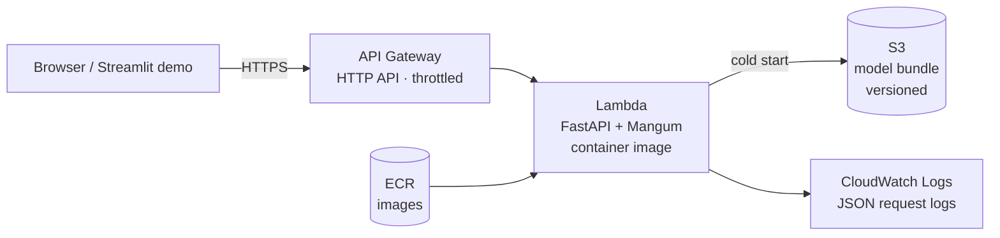

# Deploying the API to AWS

The API runs **serverless on AWS**: the same FastAPI app, wrapped with [Mangum](https://github.com/jordaneremieff/mangum), runs as a Lambda container image behind an API Gateway HTTP API. The image holds only code; the trained model bundle lives in a private S3 bucket and is downloaded once per Lambda container at cold start. Everything is defined in Terraform (`infra/terraform/`).



## What Terraform creates

| Resource | Notes |
|---|---|
| S3 bucket | private, encrypted, **versioned** (old models kept 30 days, so a bad model can be rolled back) |
| ECR repository | keeps the last 3 images |
| Lambda function | 1024 MB, 30 s timeout, role that can only **read** the model files |
| API Gateway HTTP API | throttled to 5 requests/s (burst 10) to protect the credits |
| CloudWatch log group | 7-day retention; the API logs one JSON line per request |
| AWS Budget | email alerts above $1 actual or the monthly limit forecast |
| GitHub OIDC role | optional (`enable_github_deploy`), Paid plan only |

## AWS Free plan (project-based sign-up)

New AWS accounts created through the project-based Free plan carry AWS-managed service control policies:

- Only the **project's own region** works (plus a few services in us-east-1 / us-west-2). Find it by trying a read-only call, e.g. `aws ecr describe-repositories --region ap-southeast-2`.
- **Identity providers can't be created**, so the GitHub OIDC deploy role is off by default; deploy from your laptop instead.
- Errors that mention *"explicit deny in a service control policy"* come from these limits.

## First deploy

Needs the AWS CLI (signed in with `aws configure`), Terraform and Docker. Commands are PowerShell; on macOS/Linux use `$(...)` for the outputs.

```powershell
# 1. Train the model bundle on the Kaggle data (forecast + calibrated 80% interval)
python -m scripts.train_final --backtest-wape 0.0912

# 2. Settings: region and alert email
cd infra\terraform
copy terraform.tfvars.example terraform.tfvars      # edit region and budget_email
terraform init

# 3. Create the bucket and image repository first (the function needs an image to exist)
terraform apply -target="aws_s3_bucket.model" -target="aws_ecr_repository.api"
$S3   = terraform output -raw model_s3_uri
$REPO = terraform output -raw ecr_repository_url
cd ..\..

# 4. Upload the model bundle
aws s3 sync models\forecaster $S3

# 5. Build and push the Lambda image
#    (Windows PowerShell mangles piped passwords, so let cmd do the pipe)
cmd /c "aws ecr get-login-password --region <REGION> | docker login --username AWS --password-stdin <ACCOUNT>.dkr.ecr.<REGION>.amazonaws.com"
docker buildx build --platform linux/amd64 --provenance=false -f Dockerfile.lambda -t "${REPO}:latest" --push .

# 6. Create everything else and print the URL
cd infra\terraform
terraform apply
terraform output api_url
```

Open `<api_url>/docs` (or just `<api_url>`, which redirects there).

## Updating

| What changed | What to run |
|---|---|
| **Code** (API, features) | step 5, then `aws lambda update-function-code --function-name demand-forecast-api --image-uri "${REPO}:latest"` |
| **Model** (retrained) | step 4, then the same `update-function-code` command so new containers start and download it |
| **Infrastructure** (`.tf` files) | `terraform apply` in `infra/terraform` |

Roll back a bad model: S3 keeps the previous versions for 30 days (S3 console → bucket → *Show versions*).

## Test the Lambda image locally

The AWS base image ships the Lambda Runtime Interface Emulator:

```bash
docker build -f Dockerfile.lambda -t demand-forecast-lambda .
docker run -p 9000:8080 -e MODEL_DIR=/models/forecaster -v "$PWD/models:/models:ro" demand-forecast-lambda
curl -d @infra/events/health.json http://localhost:9000/2015-03-31/functions/function/invocations
```

CI runs the same check on every push.

## Logs and cost

- Request logs: `aws logs tail /aws/lambda/demand-forecast-api --since 1h`
- Idle cost is close to zero: Lambda and API Gateway bill per request; storage is a few cents a month.
- The first request after a quiet period is a **cold start** (about 10–20 s: start the container, download the model). Later requests take well under a second.
- Remove everything: `terraform destroy` in `infra/terraform`.

## GitHub Actions deploy (Paid plan)

Set `enable_github_deploy = true`, run `terraform apply`, then add the repository variables `AWS_REGION`, `AWS_ROLE_ARN` (`github_deploy_role_arn` output), `ECR_REPOSITORY_URL`, `LAMBDA_FUNCTION` and `API_URL`, and run **Deploy to AWS** from the Actions tab. It signs in with OIDC (no stored keys), pushes an image tagged with the commit, updates the function and smoke-tests the live URL.
